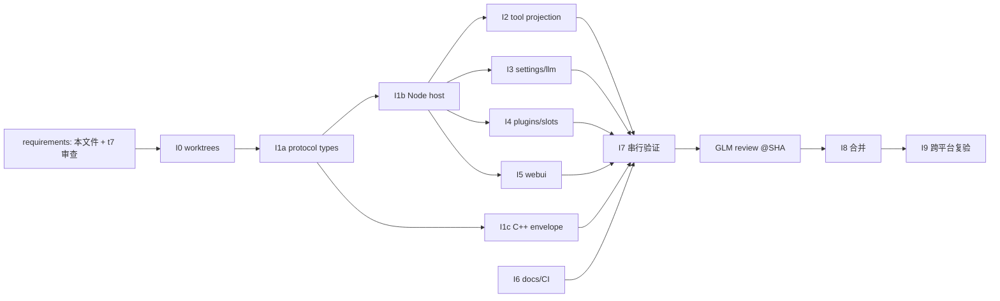

# Phase 3 实施契约与并行实施计划

> **面向 AI 代理的工作者：** 必需子技能：使用 subagent-driven-development（推荐）或 executing-plans 逐任务实现此计划。步骤使用复选框（`- [ ]`）语法跟踪进度。

**目标：** 在独立的 `dsh-qt-app` / `dsh-qt-napi` 双仓内补齐 Phase 2 未接通的宿主链路，交付工具可视化、插件管理与 SDK 兼容、LLM 配置、按需 WebUI 回退四项能力；Windows 优先、Linux 支持、macOS 缺口如实标注。

**架构：** Node 宿主持有 Cordis 运行时并 spawn Qt 原生进程，一条 stdio NDJSON 承载 protocol v1 信封（`hello`/`req`/`res`/`evt`）；Qt 只做渲染与输入，Node 只做决策与状态。WebUI 默认不监听，仅在遇到不可转换 UI 时同进程按需挂载（候选 A），第二进程与外部服务为退路。

**技术栈：** TypeScript（ESM）+ Cordis 4.1.0、C++20 / Qt 6.5+（CI 6.7.3）、QML、N-API（cmark-gfm）、Node 22.19（CI）/ 26.13（本机）、vitest、Qt Quick Test、GitHub Actions。

**规格：** 本文件 §3 契约 + `docs/PHASE-3-TOOL-VIZ.md`、`docs/PHASE-3-PLUGIN-SDK.md`、`docs/PHASE-3-SETTINGS-LLM.md`、`docs/PHASE-3-WEB-FALLBACK.md`、`docs/PHASE-3-TEST-MATRIX.md`。计划与规格冲突时以本文件 §0/§2 的版本锁与决策为准，并在 t7 审查中显式裁决。

## 全局约束

- 运行基线 `@deepseek-ai/dsh` **0.2.2-rc.1**（安装版）；源码参考 `/data/dsh-official` 4b399c39（声明 0.2.3-alpha.2）**仅用于 t3 能力面**，不用于运行时结论。
- 不改 `/data/dsh-official`、不改 EAC 父仓库、不向 EAC 合并；所有 Qt 开发只在 `/data/qt-phase3/` 下的独立 checkout 与 worktree 内。
- 协议版本 **protocol v1**；两端同批替换旧格式，**不做双格式兼容层**。
- 默认无 WebUI 监听：Node 不为 Qt 开 TCP 端口，Qt 不 spawn 任何进程。
- Windows 优先验证；Linux 支持；macOS 固定为 `gap(not-validated)`，不得表述为已支持。
- 本机重任务共享 **CPU 200% / 内存 4G 总预算**，单一验证者串行执行；日志、原始退出码、资源限制必须落盘。
- 凭据只经官方公开 API（`ctx.credentials`），不入 QML、不入日志、不入 settings 明文。
- 不提前实现、不安装依赖、不发布；本文件只做规划。

## 审查重点（Review Focus）

- 宿主进程未启动或提前退出时，用户看到的是「连接中/断开」而不是永久空白，且不会向 Node 发请求：由 I1 的 launch 失败用例钉住。
- 请求超时后迟到的回复到达：必须被丢弃且不产生第二条 UI 更新：由 I1 的 late-reply 用例钉住。
- 工具事件乱序/重复（同一 `seq` 两次、`seq` 回退、跨会话串行）：行状态不得回退、不得重放：由 I2 的去重用例钉住。
- 设置写入携带过期 `expectedRevision`：必须返回 `SETTINGS_CONFLICT` 并保持本地值不变，不得静默覆盖：由 I3 的冲突用例钉住。
- WebUI 子进程被用户手动杀掉或端口被占：只能关闭自家句柄、不得杀端口占用者，状态必须落到 `Failed` 且可重试：由 I5 的进程所有权用例钉住。

---

## 0. 版本锁与证据等级

| 对象 | 锁定值 | 证据 |
|---|---|---|
| 目标宿主（运行基线） | `@deepseek-ai/dsh` 0.2.2-rc.1，其 `node_modules/@deepseek-ai/*` 同为 0.2.2-rc.1 | `/usr/local/lib/node_modules/@deepseek-ai/dsh` 及子包 `package.json`（t1 §0） |
| 源码参考（仅能力面） | `/data/dsh-official` HEAD 4b399c39，声明 0.2.3-alpha.2 | 仅 t3 使用；不得用于运行时结论 |
| app 基仓 | fork `lbn2011/dsh-qt-app`，分支 `dev/phase-1`，SHA **33e516c32856878c37f92ddbbada81f9e437f3ba**，root tree `ce2c7db6b57ec51ee5e1c3cc1accff63791a6f58`（124 文件） | 本任务 §4 clone 后 `git rev-parse` 复核通过 |
| addon 基仓 | `lbn2011/dsh-qt-napi`，`main` = **87084a6901297a4fe9af997d4b8cdf9d829b0f67** | 本任务 clone 后复核通过；原仓 `## main...origin/main` 干净 |
| cordis | 4.1.0（`ctx.plugin`/`ctx.inject` 公开） | `dsh-qt-app/node_modules/@deepseek-ai/cordis/lib/types/registry.d.ts:99-121,198` |
| 协议 | protocol v1 | 本文件 §3 |
| 工具链 | 本机 node v26.13.1、git 2.47.3、Qt 6.8.2、qmake6/cmake 可用；CI `NODE_VERSION=22.19.0`、`QT_VERSION=6.7.3` | t1/t8/t2 探测 |

证据等级：标【官方】的接口来自 0.2.2-rc.1 的 `.d.ts` / `lib/index.js` 逐行核对（静态）；标【待验证】的运行行为（挂载、握手、认证、就绪、真实双进程）**均未实测**。

## 1. 现状与缺口（Current State → Gaps）

Phase 2 已验证可用的部分：`apply` → `QtRendererService` 注册（`src/index.ts:309-320`）、本地 N-API markdown/AST（`dsh-qt-napi/index.js`，`prebuild/linux-x64/qt-bridge.node` 存在）、主题与对话框、QML 单元/组件测试、`main.cpp:362-383` 的 stop() 平台分支（F1 已修）。

| ID | 缺口 | 证据（file:line） | 影响 |
|---|---|---|---|
| G0 | 无宿主启动入口与 Node 侧 stdio 服务端 | `dsh-qt-app/package.json` 无 `bin`/无 `dsh` 清单字段；`src`、`lib` 内 `spawn/child_process` 零命中；`src/bridge/qml-bridge.ts` 生产路径零实例化（仅 `tests/qml-bridge.test.ts`） | 一切 RPC 与事件无承载 |
| G1 | 两端线格式互不兼容 | C++ 发扁平 `{id,method,params}`（`native/main.cpp:797-800`）、只读顶层 `id`（`:815-839`）；TS 只认 `type:'qml.request'` 且回复包在 `payload` 内（`src/bridge/qml-bridge.ts:318-330,522-529`） | 请求被丢弃、回复被忽略，双向 5s 超时 |
| G2 | 无真实握手，`connected` 是假状态 | `StdioTransport::describe()` 只要 `active_` 就返回 `"connected"`（`native/main.cpp:387-392`）→ `main.qml:71-72` `nodeConnected=true` | 独立启动时 UI 显示已连接但全部超时 |
| G3 | 会话/工具事件零接线 | qt-app 全树 `session/event|assistant/message|tool/call|tool/result` 零命中；`SessionModel.qml:6` 期待 `session.updated`；`MessageModel.qml:3-12` 声称的 `dsh-qt-napi/native/MessageListModel` 不存在 | 无任何真实数据面 |
| G4 | 工具调用不可视化 | `MessageDelegate.qml:55,111` 仅 1px 边框；`callId/argsRaw/toolCallCount` 全仓 0 命中 | 目标 1 未起步 |
| G5 | 设置桥未接线、设置不回读 | `main.qml:202 settingsBridge:null`；`createSettingsStore()` 生产零调用；`BUILTIN_SETTINGS` 仅 7 项外观设置；theme/font 三写两文件 | 设置页 display-only |
| G6 | 无 LLM/供应商/模型/凭据接口 | 仓内无 `ctx.llm`/`ctx.credentials` 使用；`SettingsPanel` 无 Models 页 | 目标 3 未起步 |
| G7 | 插件管理零接线、槽位契约三处不一致 | `PluginsSettings.qml:83-85` `enabled:false`；`types.ts:62` vs `slots.ts:49` 两套形状；`SettingsPanel.qml:127` 要 `slotContributions()` 但 TS 无此方法；官方名是 `settings.section` | 目标 2 未起步 |
| G8 | 无 WebUI 回退服务 | 仓内无 webui 服务；默认无监听成立（无 webserver 依赖、无 patch、无 `.listen(`） | 目标 4 未起步 |
| G9 | 无 React→QML 转换路径 | `SlotHost.qml:170-171` 只接受 QML Component/URL；官方槽位组件是 `(props)=>ReactNode` | 插件 UI 无法落地 |
| G10 | CI 未固定 addon SHA、缺 WebEngine 模块 | `build.yml:40`/`test.yml:26` 仅 `NAPI_REPO`；checkout 步骤无 `ref`；workflow 无 qtwebengine | 不可复现构建 |
| G11 | 文档与实现矛盾 | `docs/architecture.md:3,13` 称「one process / 10ms N-API bridge」；`README.md:81-85` 教用户直接运行二进制 | 误导后续开发者 |
| G12 | QML 测试在 t3 未运行（可补） | Qt 6.8.2 已装，`qmltestrunner`/`qmllint` 在 `/usr/lib/qt6/bin`（不在 PATH） | 证据缺口，非代码缺口 |

## 2. 决策（已定 / 待定）

【已定】S1 单进程拓扑：Node spawn Qt（stdio NDJSON）。Qt 侧已只读 stdin（`native/main.cpp:326-555,963`），反向由 Qt 拉 Node 会在 Windows 引入不受控进程管理。
【已定】S2 信封 v1，破坏性替换，不做双解析。
【已定】S3 关联：`id` 每发送方单调、`epoch` 宿主启动随机、`seq` 宿主全局单调；重启由 `epoch` 隔离。
【已定】S4 设置写入只发 `settings.mutate`（路径操作），**禁止 replace**；`theme.json` 为唯一权威、native 为唯一写者。
【已定】S5 工具行沿用官方五态 `preparing|running|ok|error|stopped`，不加第六态；终态不可回退；图表不实现（官方无数据契约），仅文本/Markdown/表格。
【已定】S6 WebUI 首选候选 A：同进程 `ctx.plugin` 链，但**不重复注册**宿主已有服务（`ctx.credentials` 已存在，不再 `ctx.plugin(CredentialsLocal)`）；不写 profile、不用 loader commit。
【已定】S7 `native/main.cpp` **整文件由 host-architect-qiu 单写**；web-fallback 只新增 `native/webview_host.{h,cc}` 与接入说明（t9 §8 的段级拆分作废）。
【已定】S8 单一合并负责人 host-architect-qiu；单一验证者串行执行重任务。

【待定】P1 未知 `ui.type`：拒绝 vs 降级为文本/WebView。倾向：**降级为文本并上报 `ui.unsupported`**，但需产品确认。
【待定】P2 React 子集边界（元素/属性/事件白名单）。
【待定】P3 逐槽位 `openSlot`：0.2.2-rc.1 **无公开深链 API**（只有 `open-in-app`，语义不同），暂定为「打开 Web GUI 根 URL + 可选 query 提示」。
【待定】P4 是否保留第二进程回退（独立 session 树、关闭 reload 不共享活动会话）。
【待定】P5 是否允许 Qt 侧录入 API Key（凭据只经官方 API，需产品确认交互）。
【待定】P6 工具可视化的会话范围（当前会话 vs 历史会话回放）。

## 3. 统一契约（protocol v1）

### 3.1 信封

一行一个 JSON（UTF-8，`\n` 分隔，单行 ≤8MB；入站 ≤4MB）：

```json
{"v":1,"kind":"hello","role":"qt","epoch":"<host-epoch>","app":"0.1.0","qt":"6.8.2","caps":["tool","settings","plugins","webui"]}
{"v":1,"kind":"hello.ack","epoch":"e-7f3a","host":"0.2.2-rc.1","caps":["..."],"limits":{"maxFrame":8388608}}
{"v":1,"kind":"req","id":"qt-42","method":"tool.snapshot","params":{}}
{"v":1,"kind":"res","id":"qt-42","ok":true,"result":{}}
{"v":1,"kind":"res","id":"qt-42","ok":false,"error":{"code":"busy","message":"...","retryable":true}}
{"v":1,"kind":"evt","seq":10217,"epoch":"e-7f3a","name":"tool.row","topic":{"session":"s-1","turn":"t-3"},"payload":{}}
```

- `hello` 由 Qt 在 stdio 就绪后 500ms 内发出；宿主必须回 `hello.ack` 或 `nack{reason}`。**收到 ack 前不得发 `req`**；QML 的 `nodeConnected` 只由 ack 驱动。
- 未知 `v` → `nack{code:"protocol"}` 并断开；未知 `kind` → 忽略该行并记录（不回复、不断连）。
- 每条 `req` 恰好一条 `res`（同 `id`）；`evt` 不需要回复。

### 3.2 方法与事件（Phase 3 保留集合）

| 组 | 名称 | 方向 | 说明 |
|---|---|---|---|
| T | `host.ping` / `host.status` / `host.cancel{id}` | Qt→Node req | 存活、版本与计数、取消在飞请求 |
| T | `session.list` / `session.activate{key}` | Qt→Node req | 会话索引与切换（含历史回放开关） |
| T | `session.changed` | Node→Qt evt | 会话增删/标题变化（对应官方 `session/created|disposed`） |
| T | `tool.snapshot{sessionKey,turnId?}` | Qt→Node req | 拉取水印 `seq` + 行快照，用于重连对账 |
| T | `tool.row` | Node→Qt evt | 单行增量（含 `seq`、`state`、`phase`、`callId`、`name`、`variant`、`summary`、`argsRaw?`、`resultPreview?`、`exitCode?`、`error?`） |
| T | `tool.args` | Node→Qt evt | 流式参数增量（原始字符串，Qt 不解析） |
| T | `tool.cleared{sessionKey}` | Node→Qt evt | 会话销毁/重置 |
| M | `md.parse` / `md.render` | Qt→Node req | 走 Node N-API（保留既有语义，改名去 `markdown.` 前缀） |
| M | `code.highlight` / `theme.apply` / `theme.scale` | 本地或 req | `theme.*` 保持 native 本地处理（既有 `theme.reload` 事件不变） |
| M | `composer.submit` | Qt→Node req | 用户消息提交 |
| C | `settings.describe{ns?}` | Qt→Node req | 返回 `SettingsDescriptor[]`（secret 已脱敏）+ `revision` |
| C | `settings.mutate{ns,ops,expectedRevision}` | Qt→Node req | 仅 `{op:'set'|'unset',path,value}`；冲突回 `SETTINGS_CONFLICT` |
| C | `settings.flush{ns}` | Qt→Node req | 强制落盘（若官方有对应 API；否则延后） |
| C | `settings.changed` | Node→Qt evt | 对应官方 `settings/document-updated` |
| C | `llm.providers.list` / `llm.models.discover{providerId,baseURL?,api?,apiKey?}` | Qt→Node req | 后者可取消；`apiKey` 一次性，不落盘、不回显 |
| C | `llm.default.get` / `llm.default.set` | Qt→Node req | 默认模型 |
| C | `cred.set{ref,value}` / `cred.unset{ref}` / `cred.describe{ref}` / `cred.list` | Qt→Node req | **永不返回 secret**；`set` 单向 |
| P | `plugin.list` / `plugin.bundles` / `plugin.setEnabled` / `plugin.bundle.setEnabled` | Qt→Node req | 返回官方 `PluginInfo`/`ChangeResult` 原样（含 `restart` 语义） |
| P | `plugin.install{spec}` / `plugin.remove{name}` / `plugin.update{name,version}` / `plugin.inspect` / `plugin.versions` | Qt→Node req | 长任务：返回 `opId`，进度走 `plugin.op.progress`，`plugin.op.cancel{opId}` |
| P | `plugin.changed` | Node→Qt evt | 列表失效通知（重新拉取，不推全量） |
| S | `slot.list{surface}` / `slot.changed` | req/evt | 槽位注册表；surface 名**逐项**与官方对齐（当前已知 `settings.section`） |
| S | `ui.register{slotId,spec}` / `ui.render{slotId,props}` / `ui.action{slotId,action,payload}` | req | 转换结果 `{status:'native'|'web'|'text',tree?\|reason}`；拒绝码 `R1-R7` |
| W | `webui.state` | Node→Qt evt | `Idle|Resolving|Spawning|WaitingReady|Ready|Failed|Stopping` + `reason?` + `maskedUrl?` |
| W | `webui.open{slotId?}` / `webui.close` / `webui.probe` | req | `open` 20s 超时；返回 `{mode:'slot'|'panel',maskedUrl}` |
| W | `webui.token` | req（**仅 native 消费**） | 一次性 authenticatedUrl；C++ 拦截回复、转发 QML 前必须剥离 |

标注：【官方】`settings/llm/credentials/pluginManager` 的底层 API 全部存在于 0.2.2-rc.1（见 §0 与附录 B）；`tool.*`/`ui.*`/`webui.*`/`slot.*` 为**本项目待新增**的传输层接口。

### 3.3 错误码字典（闭合集合）

`unknown-method` · `bad-params` · `unavailable` · `busy` · `timeout` · `refused` · `internal` · `not-found` · `conflict` · `unsupported` · `cancelled` · `duplicate-id` · `protocol` · `SETTINGS_CONFLICT`（透传官方） · `ManagementError.*`（透传官方代码）。

### 3.4 超时 / 取消 / 重复与乱序

- 默认超时 5000ms；`md.render` 10000ms；`tool.snapshot` 5000ms；`plugin.install|update|remove` 120000ms；`webui.open` 20000ms；`webui.token` 5000ms。
- 超时只 reject，**不取消底层工作**；迟到 `res` 按 `id` 丢弃并计数 `lateReplies`。
- `host.cancel{id}`：宿主尽力中止并必定回 `res{ok:false,code:'cancelled'}`；已完成后 cancel 幂等返回。
- 重复 `id`（同 epoch）→ `res{code:'duplicate-id'}`，不执行第二次。
- `evt` 去重：Qt 按 `epoch` + `seq` 单调过滤；`seq <= lastSeq` 丢弃；`epoch` 变化则清空并请求 `tool.snapshot` 全量对账。

### 3.5 生命周期与 dispose

- Node：`apply` 创建 `HostBridgeService`（`inject:['qtRenderer']`）→ spawn → handshake → 事件订阅（`session/event`、`tools/*`、`settings/document-updated`）→ dispose 时退订、`kill` 子进程（先 SIGTERM/`CloseMainWindow`，2s 后强杀）、拒绝在飞请求为 `unavailable`。
- Qt：`hello` → `ack` → 正常请求；stdin EOF → 显示断开浮层并 2s 内退出；`WebuiService` 关闭顺序为 Stopping → Ready 之前状态不可直接跳 Idle。
- 任一侧 `dispose` 后不得再 emit 事件（sink 先摘除）。

## 4. 仓库、worktree、分支与所有权

已创建（本任务实际执行，非计划）：

| repo | 路径 | 角色 | SHA |
|---|---|---|---|
| app | `/data/qt-phase3/app/base` | 独立基仓（`dev/phase-1`） | 33e516c32856878c37f92ddbbada81f9e437f3ba（tree `ce2c7db…` 复核一致） |
| app | `/data/qt-phase3/app/wt/integration` | 集成分支 worktree（`phase3/integration`） | c2907d3（本文件与 5 份 Phase-3 文档的落盘提交；基线 33e516c） |
| addon | `/data/qt-phase3/addon/base` | 独立 addon 基仓（`main`） | 87084a6901297a4fe9af997d4b8cdf9d829b0f67 |

**I0 已完成（2026-11-23T18:46Z，台账 `/data/qt-phase3/logs/I0-baseline.txt`）**：创建前逐条核验目标路径不存在、分支名不冲突、base clone 干净、磁盘可用 5.9G；创建后 6 棵 worktree 的 HEAD 均等于基线 SHA，`git status --porcelain` 全为空。使用 `git -C <base> worktree add` 而非 `create_worktree` 工具，理由：该工具一次只操作当前仓并把会话 cwd 切到新树，无法在同一轮内为两个仓建 6 棵并保持固定路径；效果等价（同一 `git worktree add`），路径与 SHA 已逐条记录。

| 成员 | repo | worktree（实际） | 分支 | HEAD / base SHA | 交付 SHA |
|---|---|---|---|---|---|
| host-architect-qiu | app | `/data/qt-phase3/app/wt/qiu-host` | `phase3/host-qiu` | 33e516c | 待填 |
| host-architect-qiu | addon | `/data/qt-phase3/addon/wt/qiu-host` | `phase3/host-qiu` | 87084a6 | 待填 |
| tools-ui-cn | app | `/data/qt-phase3/app/wt/tools-cn` | `phase3/tools-cn` | 33e516c | 待填 |
| plugin-sdk | app | `/data/qt-phase3/app/wt/plugin-sdk` | `phase3/plugin-sdk` | 33e516c | 待填 |
| settings-llm | app | `/data/qt-phase3/app/wt/settings-llm` | `phase3/settings-llm` | 33e516c | 待填 |
| web-fallback | app | `/data/qt-phase3/app/wt/web-fallback` | `phase3/web-fallback` | 33e516c | 待填 |

规则：一人一棵、禁止共用；`create_worktree` 无法切换 cwd 时按阻塞上报，不得假装创建；worktree 只 `git worktree remove`，不 `rm -rf`；两仓均**无 `.gitmodules`**（已核验）。

## 5. 任务分解

> 任务编号 I0–I9；每项交付物必须独立可测。`RQ-*` 映射到 §9 验收矩阵。
> **版本继承：** 除任务内另行注明外，每项任务一律继承 §0 版本锁（宿主 0.2.2-rc.1、protocol v1、app 基线 33e516c、addon 87084a6、cordis 4.1.0）。I1a 之后所有任务只能 `import type` `src/bridge/protocol.ts`，不得各自定义信封。

### I0：工作树与基线落地（owner：host-architect-qiu）

**文件：** 无源码改动；产出 `/data/qt-phase3/logs/I0-baseline.txt`。
**Objective：** 为 5 名实现者建立隔离 worktree，冻结 base SHA 与分支名。
**inScope：** app/addon clone 已存在时复用；`git worktree add`；分支创建；台账记录。
**outOfScope：** 任何源码修改、依赖安装、CI 触发。

- [ ] 逐成员检查目标路径不存在或空、base clone 干净、磁盘 ≥5G
- [ ] `git -C /data/qt-phase3/app/base worktree add <path> -b <branch> 33e516c…`
- [ ] addon 同理（仅 qiu-host 一棵）
- [ ] 每棵 worktree 记录 `git rev-parse HEAD`、`git status --short`、branch
- [ ] 写入台账并回填 §4

**验收：** 5 棵 app worktree + 1 棵 addon worktree 存在；HEAD 均为基线 SHA；脏树为空；无同一分支被两处 checkout。
**verify：** `for d in /data/qt-phase3/app/wt/*; do git -C "$d" rev-parse --abbrev-ref HEAD; done`

### I1a：protocol v1 类型与 ODJSON 编解码（owner：qiu-host）

**文件：** 创建 `src/bridge/protocol.ts`、`tests/protocol.test.ts`；修改 `src/bridge/index.ts`。
**Objective：** 冻结 `Envelope`、`Req`、`Res`、`Evt`、错误码联合类型与序列化/校验函数，供其他成员先接口后实现。
**inScope：** 类型、`encodeFrame`/`decodeFrame`、`PROTOCOL_VERSION=1`、错误码常量、`makeError`。
**outOfScope：** 传输、spawn、方法实现。

- [ ] 写测试：合法 `req` 往返、超大帧拒绝、未知 `kind` 忽略、未知 `v` 返回 `protocol`、`res` 必带 `id`
- [ ] 运行测试确认失败：`pnpm test tests/protocol.test.ts`（FAIL：模块不存在）
- [ ] 实现 `src/bridge/protocol.ts`（导出 `PROTOCOL_VERSION`、`EncodeResult`、`DecodeResult`、`PROTOCOL_ERRORS`）
- [ ] 运行测试确认通过
- [ ] Commit：`feat(protocol): freeze protocol v1 envelope types`

**验收：** RQ-01/RQ-02 类型冻结；其他成员可 `import type { Envelope }`。
**verify：** `pnpm typecheck && pnpm test tests/protocol.test.ts`

### I1b：Node 侧 HostBridge 与 launcher（owner：qiu-host）

**文件：** 创建 `src/host/launcher.ts`、`src/host/transport.ts`、`src/host/bridge-service.ts`、`tests/host-launcher.test.ts`；修改 `src/index.ts:309-320`（apply 内 new 服务 + effect）、`src/types.ts`。
**Objective：** Node 宿主 spawn Qt 二进制、握手、收/发 `req|res|evt`、管理在飞请求与超时。
**inScope：** `spawn`（`stdio:['pipe','pipe','pipe']`）、`hello.ack`、请求路由、超时、`cancel`、`dispose`、`DSH_QT_APP_BINARY` 覆盖、launch 失败上报 `unavailable`。
**outOfScope：** 具体方法业务（由 I2–I5 注册 handler）；WebUI。

- [ ] 写测试：伪 stdio 对（`PassThrough`）完成 hello/ack；请求超时后迟到回复被丢弃；子进程退出 → 在飞请求全 `unavailable`；重复 id → `duplicate-id`
- [ ] 运行确认失败
- [ ] 实现 launcher（`spawn(bin,{stdio:['pipe','pipe','inherit']})`，`windowsHide:true`）与 transport（按 `\n` 切帧、4MB/8MB 上限）
- [ ] 实现 `HostBridgeService.register(method, handler)` 与 `emit(name,payload,seq)`
- [ ] 运行确认通过
- [ ] Commit：`feat(host): spawn qt host process and speak protocol v1`

**验收：** RQ-01/RQ-02 passed；`apply` 后服务注册进 `ctx.hostBridge`。
**verify：** `pnpm typecheck && pnpm test tests/host-launcher.test.ts`

### I1c：C++ 信封与握手（owner：qiu-host，整文件单写）

**文件：** 修改 `native/main.cpp`（信封解析/发送、hello、epoch/seq、断线）；创建 `tests/qml/tst_protocol.qml`。
**Objective：** Qt 端说 protocol v1，收到 ack 才置 connected，stdin EOF 退出。
**inScope：** `StdioTransport` 不变；`DshQtBridge::handleMessage_` 重写为 kind 判别；`submit_` 发 `req`；新增 `epoch`/`emitEvent`。
**outOfScope：** WebEngine（I5 只加独立文件与调用点）、业务方法语义。

- [ ] 写 QML/C++ 可测断言：无 ack 时 `transportState=="connecting"`；收到 `hello.ack` → `"connected"`；`qml.event` 未知 name 忽略
- [ ] 运行 QML 测试确认失败
- [ ] 改写处理器与发送端（旧扁平格式删除）
- [ ] 运行确认通过
- [ ] Commit：`feat(native): protocol v1 envelope and handshake`

**验收：** RQ-01 passed；独立启动不再显示假连接。
**verify：** `cmake --build build --target qml-tests && ./build/tests/qmltestrunner -input tests/qml`（目标名以 CMakeLists 为准）

### I2：工具事件投影与 ToolCallModel（owner：tools-ui-cn）

**文件：** 创建 `src/tools/projection.ts`、`src/tools/dto.ts`、`qml/models/ToolCallModel.qml`、`qml/views/ToolCallRow.qml`、`tests/tools-projection.test.ts`、`tests/qml/tst_toolcallmodel.qml`；修改 `qml/views/ChatView.qml`（Connections 增加 `tool.*`）、`qml/views/MessageDelegate.qml`（改挂 ToolCallRow）。
**Objective：** `session/event` → `tool.row`/`tool.args` 投影；QML 五态渲染、参数流式、结果截断。
**inScope：** 订阅 `session/event`（`tool/call|tool/result`）、`variant` 映射、R-JSON1..4、去重（`epoch+seq`）、重连快照对账、三层截断（8/9 行、2000 行、200KB）。
**outOfScope：** 图表、历史会话回放（P6 未定）、MessageModel role 扩展。

- [ ] 写测试：五态迁移表（含终态不可回退、未知迁移丢弃并计数）；乱序/重复 seq；参数为不完整 JSON 时显示原始片段；`result` 超 200KB 截断
- [ ] 运行确认失败
- [ ] 实现 `projection.ts`（纯函数，输入官方事件的 `data`，输出 `ToolRowDTO`）
- [ ] 实现 `ToolCallModel.qml`（`ListModel` + `applyRow`）与 `ToolCallRow.qml`
- [ ] 运行确认通过
- [ ] Commit：`feat(tools): project tool events into tool rows`

**验收：** RQ-03/RQ-04 passed；无图表代码。
**verify：** `pnpm test tests/tools-projection.test.ts && cmake --build build --target qml-tests`

### I3：设置 RPC + LLM/凭据（owner：settings-llm）

**文件：** 创建 `src/bridge/settings-rpc.ts`、`src/llm/directory.ts`、`src/llm/operations.ts`、`src/credentials/rpc.ts`、`qml/views/settings/SettingsBridge.qml`、`qml/views/settings/ModelsForm.qml`、`tests/settings-rpc.test.ts`、`tests/llm-operations.test.ts`；修改 `src/index.ts`（apply 注入段）、`src/settings/qml-bridge.ts`（复用而非重复实现）、`qml/main.qml:202`（`settingsBridge` 绑定）、`qml/views/settings/SettingsPanel.qml`。
**Objective：** 把 `ctx.settings`/`ctx.llm`/`ctx.credentials` 投影成 Qt 可用接口；写入只 mutate、冲突透传、secret 脱敏。
**inScope：** `settings.describe|mutate`、`llm.providers.list|models.discover|default.*`、`cred.set|unset|describe|list`、设置页字段渲染、重启回读。
**outOfScope：** LLM 请求执行（沿用宿主）、密钥明文展示（P5 未定）、theme 迁移（单独评审）。

- [ ] 写测试：describe 返回 `revision` 与脱敏值；mutate 带过期 revision → `SETTINGS_CONFLICT`；`cred.set` 后 `describe` 不含 value；`models.discover` 取消 → `cancelled`
- [ ] 运行确认失败
- [ ] 实现 RPC handler（注入依赖，不 new 第二个 SettingsStore）
- [ ] 实现 `SettingsBridge.qml`（属性 + `applySettingsChanged`）与 Models 页
- [ ] 运行确认通过
- [ ] Commit：`feat(settings): settings/llm/credentials rpc projection`

**验收：** RQ-05/RQ-06/RQ-07 passed；日志中无 secret。
**verify：** `pnpm typecheck && pnpm test tests/settings-rpc.test.ts tests/llm-operations.test.ts`

### I4：插件管理与槽位/UI 转换（owner：plugin-sdk）

**文件：** 创建 `src/plugins/service.ts`、`src/plugins/slots.ts`（统一槽位形状）、`src/ui/converter.ts`、`src/ui/controls.ts`、`qml/views/settings/PluginsSettingsBridge.qml`、`tests/plugins-service.test.ts`、`tests/ui-converter.test.ts`；修改 `src/types.ts:62`、`src/settings/slots.ts:49`、`qml/views/settings/PluginsSettings.qml:83`（`enabled` 绑定）、`qml/views/settings/SettingsPanel.qml:127`。
**Objective：** 暴露官方 PluginManager 能力；槽位注册表统一；有限 UI 意图 → QML 组件/文本/Web 回退。
**inScope：** `plugin.*` 全组、`slot.list`、`ui.render` 的 6 控件词表与 R1–R7 拒绝码、`unknown ui.type` 走 P1 默认（实现前须裁决）。
**outOfScope：** 真实 npm 安装联网测试（CI 用 fake registry）、plugin-kit 生成物加载（版本错位未裁决）。

- [ ] 写测试：`plugin.setEnabled` 透传 `ChangeResult.restart`；安装失败收敛为 `application='failed'` 且不抛；`ui.render` 对 `<div onClick>` 返回 `R3`；未知 type 返回 P1 裁决值
- [ ] 运行确认失败
- [ ] 实现 service（直接调 `ctx.pluginManager`，不复制官方逻辑）与 converter（纯函数）
- [ ] 实现 QML 桥接与按钮启用
- [ ] 运行确认通过
- [ ] Commit：`feat(plugins): plugin manager bridge and slot/ui conversion`

**验收：** RQ-08/RQ-09 passed；`PluginsSettings` 按钮可用。
**verify：** `pnpm test tests/plugins-service.test.ts tests/ui-converter.test.ts`

### I5：按需 WebUI 回退（owner：web-fallback）

**文件：** 创建 `src/webui/service.ts`、`src/webui/process.ts`、`native/webview_host.h`、`native/webview_host.cc`、`qml/views/WebFallbackPanel.qml`、`tests/webui-service.test.ts`；修改 `CMakeLists.txt`（`option(DSH_QT_WEBENGINE OFF)`）、`native/main.cpp`（仅调用点/声明）、`.github/workflows/build.yml:153-157`。
**Objective：** 默认不监听；需要时同进程挂载（候选 A）或第二进程；token 只经 C++、QML 只见脱敏 URL。
**inScope：** `webui.state|open|close|probe`、候选 A 的 `ctx.plugin` 链（用现有 `ctx.credentials`）、候选 B/C、状态机与退避、WebEngine 初始化顺序、进程所有权（只杀自家句柄）。
**outOfScope：** 逐槽位深链（P3）、WebEngine 打包体积决策、外部服务接管。

- [ ] 写测试：默认状态 `Idle` 且无监听（静态守卫：源码无 `.listen(`）；`open` 超时 → `Failed{reason:'timeout'}`；子进程被杀 → `Failed` 且不扫端口；`webui.token` 回复不得进入 QML 信号
- [ ] 运行确认失败
- [ ] 实现 service/process 与状态机
- [ ] 实现 `webview_host`（`QWebEngineQuick::initialize()` 于 `QGuiApplication` 前，main.cpp 只加调用点）
- [ ] 运行确认通过
- [ ] Commit：`feat(webui): on-demand web ui fallback with token isolation`

**验收：** RQ-10 passed；默认不监听可静态验证。
**verify：** `pnpm test tests/webui-service.test.ts && cmake -S . -B build -DDSH_QT_WEBENGINE=OFF && cmake --build build --target dsh-qt-app -j2`

### I6：文档一致性 + CI 双仓锁（owner：qiu-host）

**文件：** 修改 `docs/architecture.md:3,13`、`README.md:81-85`、`.github/workflows/build.yml:40,57-61,153-157`、`test.yml:26,50`、`CMakeLists.txt`。
**Objective：** 文档与真实拓扑一致；CI 固定 addon SHA。
**inScope：** 修正「同进程 N-API」表述；README 改为「由宿主启动」；`NAPI_REF` 固定 87084a6（或 `napi-ref.json`）；qtwebengine modules。
**outOfScope：** 改动 CI 的触发策略、macOS 转为支持。

- [ ] 写静态测试：`tests/docs-consistency.test.ts` 检查 architecture/README 不含「same process」类断言且含 `protocol v1`
- [ ] 运行确认失败
- [ ] 改文档与 workflow（`ref: ${{ env.NAPI_REF }}`）
- [ ] 运行确认通过
- [ ] Commit：`docs+ci: align topology docs and pin addon sha`

**验收：** RQ-11/RQ-12 passed；`grep -r 87084a6 .github` 命中。
**verify：** `pnpm test tests/docs-consistency.test.ts && grep -n 'NAPI_REF' .github/workflows/*.yml`

### I7：串行验证（owner：quality-reviewer 或单一验证者）

**文件：** `docs/test-records/phase-3-results.md`（新建）。
**Objective：** 在共享预算内串行执行全量真实命令，记录原始证据。
**inScope：** typecheck/test/build/qml-tests/qmllint/addon `npm test`+`verify`/e2e（双进程）；资源限制与退出码。
**outOfScope：** 修复失败（回派实现者）。
**verify 记录：** 每条命令写 `{command, exitCode, logPath, cpuLimit, memLimit, sha}`；`skipped>0` 即失败。

### I8：集成合并（owner：host-architect-qiu，唯一）

- 按 I1a → I1b/I1c → I2/I3/I4/I5 → I6 顺序合入 `phase3/integration`。
- 每个被合入提交必须已有 GLM 审查通过（固定 SHA）；冲突显式解决后**重新送审**；记录 merge SHA 到 §4 交付列。
- 禁止强推 `phase3/integration` 与成员分支；合并后跑一次 I7 的门禁子集。

### I9：合并版本跨平台复验（owner：host-architect-qiu + CI）

- Windows（`windows-2022`，真实 Qt 6.7.3 + MSVC）与 Linux（`ubuntu-22.04`）双绿；addon `npm test` 绿；e2e 双进程绿。
- 分支绿不等于集成绿：以集成分支的 CI 结果为准；macOS 保持 `gap(not-validated)`。

## 6. 依赖图（DAG）



并行度：I2/I3/I4/I5 在 I1a 后可同时开工（各自 worktree，接口只用 `protocol.ts` 类型与 §3 表）。I1b 与 I1c 可并行（同一 owner 串行实现，避免 main.cpp 争用）。

## 7. 共享文件与单一所有权

| 文件 | 所有者 | 其他成员如何接入 |
|---|---|---|
| `native/main.cpp` | host-architect-qiu（整文件） | 只提交「需要在何处调用」的说明；I5 只加 `webview_host` 调用点建议 |
| `src/index.ts` | host-architect-qiu 合并；区域所有者见下 | 成员只改自己区域，冲突由 I8 解决 |
| `qml/main.qml` | host-architect-qiu（合并） | tools-ui 加信号、web-fallback 加 WebView 入口，均以最小补丁提交 |
| `CMakeLists.txt` / `.github/workflows/*` | host-architect-qiu | 通过 issue 文本提出需求，不直接改 |
| `src/bridge/protocol.ts` | host-architect-qiu | 其他成员只 import，不本地改 |
| `src/bridge/qml-bridge.ts` | settings-llm（settings 段）+ qiu-host（传输段） | 先定接口再改，按依赖顺序 |

`src/index.ts` 区域：`:119-172` 服务构造与 N-API 降级 → qiu-host；`:176-199` markdown/highlight → tools-ui-cn；`:210-241` dialog → tools-ui-cn；`:244-284` views/slots/surfaces → plugin-sdk；`apply` 内新增 settings/webui 注入段 → settings-llm / web-fallback；`apply` 本体 → qiu-host。

## 8. 合并、回滚与清理

- 合并负责人：host-architect-qiu；按 §6 依赖顺序合入**已审查的固定 SHA**。
- 冲突：显式解决 → 复审 → 再合；不允许用「覆盖目录」方式解决。
- 回滚：`git revert <merge-sha>` 到集成分支，不改写历史；成员分支不 rebase 后强推。
- 清理：只有「已合并 + 无未提交内容 + 已确认提交保留」才 `git worktree remove`；磁盘释放写入台账。
- 失败历史必须留在 `docs/test-records/phase-3-results.md`，不删日志。

## 9. 验收矩阵（与 t10 衔接）

| Req | 内容 | 层级 | 覆盖任务 | 钉住用例 |
|---|---|---|---|---|
| RQ-01 | 启动/握手/假连接消除 | E2E + C++ | I1a/I1b/I1c | `tst_protocol.qml`、host-launcher |
| RQ-02 | 请求超时/取消/迟到回复/重复 id | U + E2E | I1a/I1b | host-launcher |
| RQ-03 | 会话与工具事件投影、去重、重连对账 | U | I2 | tools-projection |
| RQ-04 | 工具行五态与截断、无图表 | Q | I2 | `tst_toolcallmodel.qml` |
| RQ-05 | settings describe/mutate/冲突/回读 | U + E2E | I3 | settings-rpc |
| RQ-06 | 供应商/模型发现/默认模型 | U | I3 | llm-operations |
| RQ-07 | 凭据不入 QML/日志/设置 | U + 静态 | I3 | settings-rpc（secret 断言） |
| RQ-08 | 插件列举/启停/安装失败收敛 | U | I4 | plugins-service |
| RQ-09 | 槽位统一 + 有限转换 + 拒绝码 | U + Q | I4 | ui-converter |
| RQ-10 | WebUI 默认无监听/所有权/认证/token | U + 静态 + E2E | I5 | webui-service |
| RQ-11 | 双仓 SHA 固定 | 静态 | I6 | docs-consistency + grep |
| RQ-12 | 文档拓扑一致 | 静态 | I6 | docs-consistency |

门禁沿用 t10 §4 G1–G6：退出码保真、零测试失败、日志空失败、禁 echo 兜底、双仓 SHA、yml 检查；证据 JSON 见 t10 §5。

## 10. 平台与产出缺口

- Windows：优先，但本机未构建；CI `windows-2022` 为唯一真实 MSVC/Qt 证据。
- Linux：可本机构建与 QML 测试（Qt 6.8.2）；`qmltestrunner`/`qmllint` 在 `/usr/lib/qt6/bin`，需显式 PATH。
- macOS：`gap(not-validated)`；CI leg 若保留则标 allowed-failure，不得计入验收。
- 生产就绪缺口独列：安装器/签名/更新管道不在本计划范围；addon 预编译矩阵仍需扩展。

## 11. 待定与决策请求（交 captain / t7）

| ID | 问题 | 选项 | 倾向 |
|---|---|---|---|
| P1 | 未知 `ui.type` | 拒绝 / 文本降级 / WebView | 文本降级 + `ui.unsupported` |
| P2 | React 子集边界 | 6 控件 / 12 控件 | 6 控件先行（`schema.ts` 词表） |
| P3 | 逐槽位 openSlot | 根 URL+query / 不做 | 根 URL+query，明示非深链 |
| P4 | 第二进程回退是否保留 | 保留 / 删除 | 保留为退路，默认不启用 |
| P5 | Qt 侧录入 API Key | 允许 / 只读 | 只读（密码框提交给宿主凭据 API） |
| P6 | 工具历史会话回放 | 仅当前 / 支持历史 | 仅当前会话（先可用） |
| V1 | 同进程挂载真实可行性 | 需实测 | I5 首步先跑最小挂载 smoke |
| V2 | 真实双进程 e2e | 需实测 | I7 必跑 |
| V3 | addon 全量预编译 | 需 CI | 非本阶段验收 |
| V4 | plugin-kit 版本错位（cordis 4.1.0 vs pin 4.0.6-alpha.1） | 升级/隔离 | 本阶段不解决，SDK 文档标注 |

## 附录 A：t9 47 条接口映射（保留 / 裁剪 / 延后）

- 保留（Phase 3 必需）：`host.ping|status|cancel`、`session.list|activate|changed`、`tool.snapshot|row|args|cleared`、`md.parse|render`、`code.highlight`、`composer.submit`、`settings.describe|mutate|changed`、`llm.providers.list|models.discover|default.get|default.set`、`cred.set|unset|describe`、`plugin.list|setEnabled|install|remove|update|inspect|versions|op.progress|changed`、`slot.list`、`ui.render|action`、`webui.state|open|close|probe|token`。
- 裁剪（本阶段不做）：`tool.event` 旧命名（并入 `tool.row`）、`plugin.bundles` 单独事件（改拉取）、`settings.flush` 若无官方 API 则延后。
- 延后：`slot.changed` 推送（先轮询）、`ui.register` 外部 spec 注册（先内置 6 控件）、`webui.openSlot`（P3）。

## 附录 B：file:line 速查

| 事实 | 位置 |
|---|---|
| 旧扁平请求 | `native/main.cpp:797-800`；回复解析 `:815-839` |
| 假连接 | `native/main.cpp:387-392`；`qml/main.qml:71-72` |
| 桥未实例化 | `src/bridge/qml-bridge.ts:242`（类）、生产零调用；仅 `tests/qml-bridge.test.ts` |
| apply 现状 | `src/index.ts:309-320`；`lib/index.js:209` |
| 工具行占位 | `qml/components/MessageDelegate.qml:55,111` |
| 设置桥 null | `qml/main.qml:202`；`settingsBridge` 无填充路径 |
| 插件按钮禁用 | `qml/views/settings/PluginsSettings.qml:83-85` |
| 槽位形状冲突 | `src/types.ts:62` vs `src/settings/slots.ts:49`；`SettingsPanel.qml:127` |
| 官方设置描述符 | `@deepseek-ai/dsh-settings/lib/types/index.d.ts:8-19,96,114` |
| 官方 LLM | `dsh-llm/lib/types/index.d.ts:281,295,317`；`types.d.ts:212-217,231-264,278-295,315-326` |
| 官方插件管理 | `dsh-plugin-manager/lib/types/index.d.ts:122,128,187,193,208,220,226`；错误码 `types.d.ts:40` |
| 官方凭据 | `dsh-credentials/lib/types/index.d.ts:99-184` |
| Web 就绪播报 | `dsh-web-app/lib/index.js:32,156-176` |
| WebServer 监听 | `dsh-host-webserver/lib/index.js:458,546`；类型 `lib/types/index.d.ts:170-184` |
| 会话事件 | `dsh-session/lib/types/index.d.ts:63`；信封 `types.d.ts:497-520`；`tool/call:362-368`、`tool/result:382-396` |
| 工具行模型 | `dsh-client-ui-tool/lib/types/client/tool/models/tool-call-model.d.ts:12,14,44-64` |